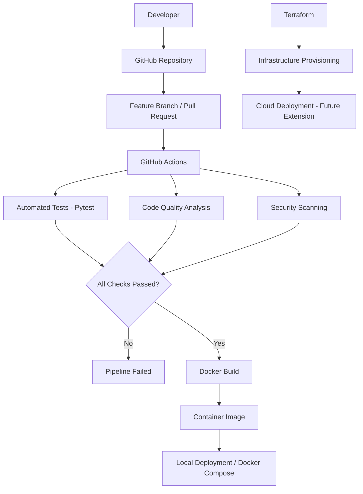

# DevOps CI/CD Platform


**An end-to-end DevOps engineering project focused on CI/CD automation, containerization, Infrastructure as Code, software quality, and security.**

## Overview

DevOps CI/CD Platform is a hands-on engineering project designed to demonstrate modern DevOps practices using open-source technologies and GitHub.

The project starts with a REST API built with Python and FastAPI and progressively evolves into an automated CI/CD platform integrating Docker, GitHub Actions, Terraform, and security scanning tools.

The main objective is to simulate a real-world software delivery workflow, from source code management and automated testing to containerization and deployment automation.

**Project philosophy:** Build, Test, Secure, Automate, and Deploy — without requiring paid cloud infrastructure.

## Project Objectives

- Build and maintain a REST API using FastAPI.
- Implement automated testing with Pytest.
- Containerize applications using Docker.
- Design CI/CD pipelines with GitHub Actions.
- Apply Infrastructure as Code principles using Terraform.
- Integrate automated code quality and security checks.
- Implement Git branching strategies and Pull Request workflows.
- Practice deployment automation and environment management.
- Document architecture, processes, and technical decisions.

## Architecture

### Target CI/CD Architecture

The following diagram represents the intended architecture as the project evolves.



> Note: The API and automated tests are currently implemented. The remaining pipeline stages are part of the development roadmap.

## Technology Stack

| Technology | Purpose |
|---|---|
| Python 3.13 | Application runtime |
| FastAPI | REST API framework |
| Uvicorn | ASGI application server |
| Pytest | Automated testing |
| HTTPX | HTTP client and API testing |
| Git | Version control |
| GitHub | Source code management |
| Docker | Application containerization |
| Docker Compose | Local service orchestration |
| GitHub Actions | CI/CD automation |
| Terraform | Infrastructure as Code |
| Trivy | Container security scanning |
| SonarQube | Code quality analysis |

## Repository Structure

```text
devops-cicd-platform/
│
├── .github/
│   └── workflows/
│       └──                 # GitHub Actions workflows
│
├── app/
│   ├── __init__.py
│   └── main.py              # FastAPI application
│
├── tests/
│   └── test_main.py         # Automated API tests
│
├── terraform/
│   ├── environments/        # Environment configurations
│   └── modules/             # Reusable Terraform modules
│
├── .dockerignore
├── .gitignore
├── Dockerfile
├── docker-compose.yml
├── requirements.txt
├── README.md
└── LICENSE
```

## Application Components

### 1. REST API

The application is developed using FastAPI and exposes three HTTP endpoints.

| Method | Endpoint | Description |
|---|---|---|
| GET | `/` | Returns application information |
| GET | `/health` | Checks application health |
| GET | `/api/v1/status` | Returns application status |

Example health check response:

```json
{
  "status": "healthy"
}
```

### 2. Automated Testing

Pytest is used to validate application behavior.

The current test suite includes:

- Root endpoint validation.
- Health endpoint validation.
- Application status validation.
- HTTP response status verification.
- JSON response validation.

Run the tests:

```bash
python -m pytest -v
```

Current baseline:

```text
3 passed
```

### 3. Containerization

Docker will be used to package the application and its dependencies into a portable container image.

Planned capabilities:

- Dockerfile optimization.
- Image building.
- Container execution.
- Docker Compose orchestration.
- Container health checks.
- Reproducible application environments.

### 4. CI/CD Automation

GitHub Actions will orchestrate the automated software delivery process.

**Continuous Integration (CI)**

1. Source code checkout.
2. Python environment setup.
3. Dependency installation.
4. Automated testing.
5. Code quality analysis.
6. Security scanning.

**Continuous Delivery (CD)**

1. Docker image build.
2. Image validation.
3. Deployment preparation.
4. Automated deployment to the target environment.

### 5. Infrastructure as Code

Terraform will be used to define reusable infrastructure configurations.

The Terraform structure will support:

- Modular infrastructure design.
- Environment separation.
- Variable management.
- Resource validation.
- Infrastructure planning.

The project will initially focus on local validation to avoid cloud infrastructure costs.

## Getting Started

### Prerequisites

Make sure you have installed:

- Python 3.13+
- Git
- Docker Desktop
- Visual Studio Code (recommended)

### 1. Clone the repository

```bash
git clone https://github.com/YOUR_USERNAME/devops-cicd-platform.git

cd devops-cicd-platform
```

### 2. Create a Python virtual environment

Windows PowerShell:

```powershell
py -3.13 -m venv .venv
```

Activate the environment:

```powershell
.\.venv\Scripts\Activate.ps1
```

### 3. Install dependencies

```bash
python -m pip install -r requirements.txt
```

### 4. Run the application

```bash
python -m uvicorn app.main:app --reload
```

The API will be available at:

`http://127.0.0.1:8000`

### 5. Access API documentation

Swagger UI:

`http://127.0.0.1:8000/docs`

ReDoc:

`http://127.0.0.1:8000/redoc`

### 6. Execute automated tests

```bash
python -m pytest -v
```

## Git Workflow

This project follows a feature branch development strategy.

Main branches:

- `main`: stable integration branch.
- `feature/*`: new features and enhancements.
- `fix/*`: bug fixes.

Example workflow:

```bash
# Create a feature branch
git switch -c feature/new-feature

# Review changes
git status

# Stage changes
git add .

# Commit changes
git commit -m "feat: add new feature"

# Push branch
git push -u origin feature/new-feature
```

After pushing, create a Pull Request to merge the feature branch into `main`.

All changes should be validated before merging.

## Security Principles

Security is considered throughout the development lifecycle.

Planned security practices include:

- Automated dependency and vulnerability scanning.
- Container image scanning with Trivy.
- Secure handling of secrets.
- Least privilege principles.
- Secure GitHub Actions workflows.
- Infrastructure configuration validation.

No credentials, access keys, tokens, or sensitive configuration files should be committed to the repository.

## Cost Optimization

This project is designed to run locally and use free development tools whenever possible.

The initial implementation does not require:

- AWS infrastructure.
- Paid cloud services.
- Managed Kubernetes clusters.
- Paid container registries.

Cloud deployment may be introduced as an optional future extension.

## Development Roadmap

| Phase | Scope | Status |
|---|---|---|
| 1 | Repository setup and Git workflow | Completed |
| 2 | FastAPI REST application | Completed |
| 3 | Automated tests with Pytest | Completed |
| 4 | Docker containerization | Planned |
| 5 | Docker Compose | Planned |
| 6 | GitHub Actions CI pipeline | Planned |
| 7 | Code quality and security scanning | Planned |
| 8 | Terraform modules and validation | Planned |
| 9 | Automated deployment workflow | Planned |
| 10 | Monitoring and observability | Planned |

## Learning Outcomes

This project demonstrates practical experience with:

- REST API development.
- Python dependency management.
- Automated testing.
- Git and GitHub workflows.
- CI/CD pipeline design.
- Containerization.
- Infrastructure as Code.
- Security automation.
- DevOps engineering best practices.

## License

This project is licensed under the MIT License.

See the [LICENSE](LICENSE) file for details.

---

**Author:** Erica Ruiz  
**Project:** DevOps CI/CD Platform  
**Focus:** DevOps Engineering | Cloud Infrastructure | Automation | CI/CD | Infrastructure as Code
